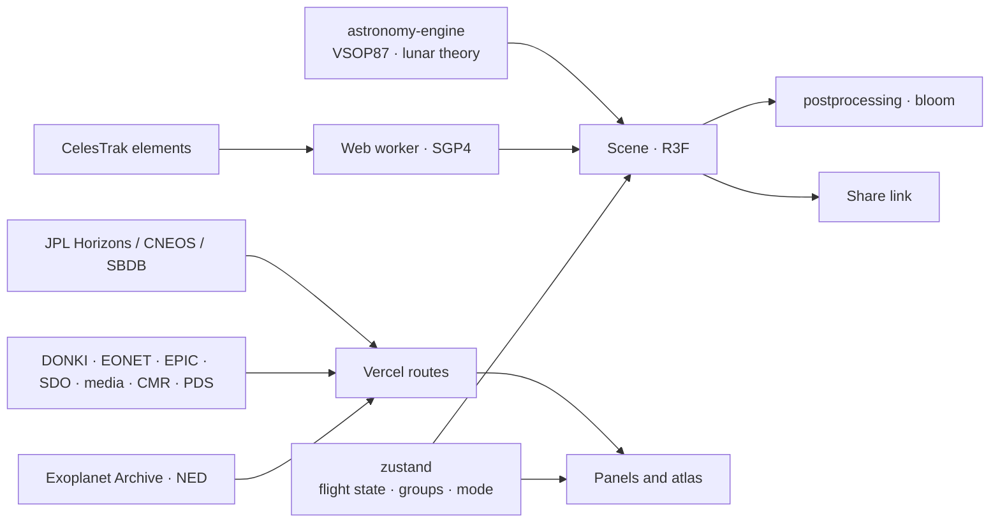

<div align="center">



<p>
  <a href="https://orbitim-3d.vercel.app"></a>
  
  
  
</p>

<p><em>The Solar System where it actually is, right now: thirty bodies, seventeen satellite groups and five comets, in a browser tab.<br>
Real ephemeris, live orbital elements and NASA imagery, with nothing simulated and no account.</em></p>

<a href="https://orbitim-3d.vercel.app"></a>

</div>


## The sky, on the clock

Orbitim renders thirty bodies: the Sun, eight planets, Ceres and Pluto, and nineteen natural satellites. Fly to any of them, scrub the clock a decade forward, and the geometry on screen is the geometry the sky will hold. Share the moment and the link carries the exact instant, rate and satellite groups.

The rest of the system is filled in too: five comets on their real orbits with tails that only unfurl near the Sun, the named dwarf planets and largest asteroids, and the main belt with its Kirkwood gaps. Around Earth, up to seventeen groups of tracked objects are propagated from real elements at frame rate, including the four great debris clouds (Iridium 33, Cosmos 2251, Fengyun 1C, Cosmos 1408).

> **Nothing on screen is simulated telemetry.** Observed imagery carries an evidence badge that keeps it apart from the rendered scene, and where a value is undefined for a body, the panel says so.


## Features

| | |
|---|---|
| **Real positions** | VSOP87 and the lunar theory via `astronomy-engine`; the moons of Jupiter, Saturn, Mars and Neptune from parent-relative elements. |
| **Live satellites** | CelesTrak element sets, SGP4-propagated in a web worker every frame, 17 switchable groups with live counts and a data-age readout. |
| **Comets and minor planets** | Halley, Encke, 67P, Hale–Bopp and NEOWISE on their JPL orbits, plus dwarf planets, named asteroids and the main belt. |
| **Scrubbable clock** | Pause, run at any rate or jump to an instant; every position, distance and phase angle follows. |
| **Shareable moments** | Share copies a link to the exact instant, rate and constellations on screen. |
| **Three modes** | *Explore*, *Scientific* (room to read the terminator and the numbers) and *Now* (time-stamped observation layers): the same scene with more or less proof around it. |
| **Laplace resonance** | At Jupiter, coloured lines tie Io, Europa and Ganymede to the planet so the 1:2:4 lock is visible as it turns. |
| **Your sky** | A topocentric readout of what is above your horizon and the next satellite pass. It never asks for your location until you choose to share it; presets stay local. |
| **Starlink rises** | An all-constellation scan for the next Starlink rises, run in a short-lived worker so WebGL never stutters. |
| **Time journeys** | Jump to measured moments in the record and see the sky as it was. |
| **Sonification** | A short, user-triggered sound for an upcoming sky event: pitch maps the days until it, pulses map its class, both explained on screen. |
| **Close-up models** | NASA 3D Resources models for selected moons, loaded only when you visit them. |
| **Light and shadow** | One lighting approach for the Sun, planetary terminators and ring shadows; Earth's cloud shell moves with simulation time. |
| **Space weather** | NASA DONKI reports through a server-side route, so the key never reaches the browser. |
| **Mobile cockpit** | On phones the scene tools fold into a single accessible cockpit: mode, orbits, sky lines, theme, language and sharing. |
| **TR / EN** | Events, space weather, local sky and satellite files in both languages, with dates and numbers in the chosen locale. |


## Beyond the scene: the atlas

Below the 3D view sits an atlas of real archives, each behind its own Vercel route with explicit 502 diagnostics for network, HTTP and malformed-JSON failures:

| Panel | Source |
|---|---|
| Confirmed exoplanets | NASA Exoplanet Archive (IPAC) |
| TESS planet candidates | NASA Exoplanet Archive TOI table |
| A nearby-universe field guide | NED, the NASA/IPAC Extragalactic Database |
| NASA media library | images.nasa.gov |
| Find NASA datasets | Earthdata CMR collection search |
| Planetary data targets | NASA PDS search API |
| Earth from L1 | DSCOVR EPIC natural-colour images |
| Earth events | NASA EONET |
| The Sun today | SDO observations |
| Close approaches and small bodies | JPL CNEOS and SBDB |
| Spacecraft trajectories | JPL Horizons |


## How it fits together



| Layer | Stack |
|---|---|
| Rendering | three.js · React Three Fiber · drei · postprocessing · GLSL |
| UI and state | React 19 · Tailwind CSS 4 · zustand · lucide |
| Astronomy | astronomy-engine · satellite.js (SGP4/SDP4) |
| Build | Vite · oxlint · Playwright |


## Türkçe özet

**Orbitim**, Güneş Sistemi'ni saatteki anın gerçek geometrisiyle gösteren gerçek zamanlı bir 3B sahne. Gezegen ve uydular VSOP87 efemerisiyle, Dünya çevresindeki 17 uydu grubu (Starlink, GPS, enkaz bulutları) canlı CelesTrak verisinden SGP4 ile her karede hesaplanıyor. Saati ileri sarabilir, istediğin cisme uçabilir, o anı link olarak paylaşabilirsin. Jüpiter'de Laplace rezonansı, kendi gökyüzün için yerel panel, Starlink geçişleri ve ötegezegenlerden NASA arşivlerine uzanan bir atlas var. Hesap yok, tarayıcıda açık anahtar yok.


## Development

```sh
npm install
npm run dev        # http://localhost:5173
npm run build      # tsc -b && vite build
npm run lint       # oxlint
npm run test:e2e   # Playwright mobile regression suite
```

The core scene needs no environment variables. For live DONKI reports, set `NASA_API_KEY` in the Vercel project (never in a `VITE_` variable). Use `vercel dev` to exercise the `api/` routes locally.

```
src/scene/      bodies, orbits, satellites, comets, belt, Laplace lines, sun surface, shaders
src/ui/         panels, clock, modes, observer, atlas catalogues, share
src/lib/        ephemeris (positions, events, illumination, passes), textures, URL state, sonification
src/flight/     camera flight and level of detail
src/workers/    SGP4 propagation off the main thread
api/            Vercel routes for JPL, NASA, IPAC and space weather
```

<div align="center">
<br>
<a href="https://github.com/kutluhangil"></a>
<sub>MIT licensed · ephemeris by astronomy-engine · elements by CelesTrak · imagery by NASA, JPL and USGS.</sub>
</div>
