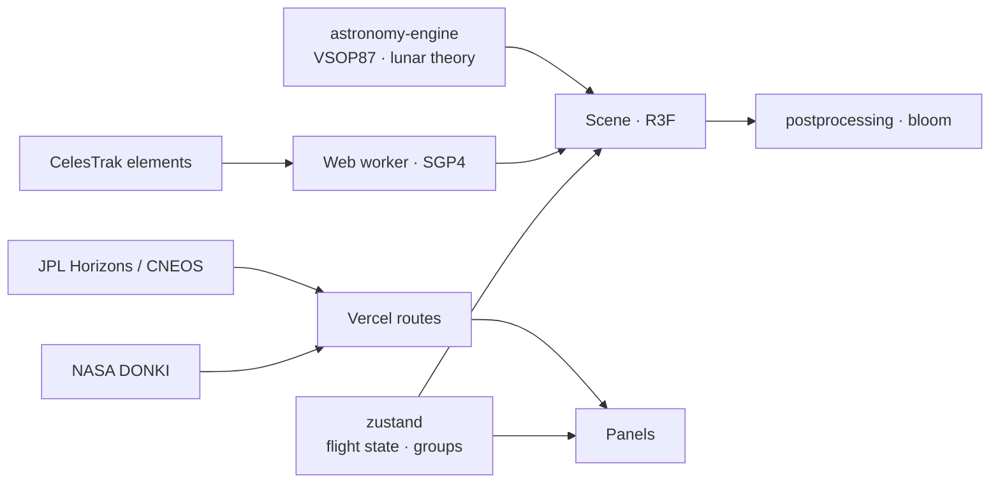

<div align="center">


<p>
  <a href="https://orbitim-3d.vercel.app"></a>
  
  
  
</p>

<p><em>A real-time 3D solar system placed by orbital mechanics for the exact instant on the clock.<br>
Real ephemeris, live orbital elements and NASA imagery, in a browser tab with nothing behind it.</em></p>

<a href="https://orbitim-3d.vercel.app"></a>

</div>


## What it is

Orbitim renders thirty bodies: the Sun, eight planets, Ceres and Pluto, and nineteen natural satellites. Fly to any of them, scrub the clock a decade forward, and the geometry on screen is the geometry the sky will hold.

The rest of the system is filled in too: five comets on their real orbits with tails that only unfurl near the Sun, the named dwarf planets and largest asteroids, and the main belt with its Kirkwood gaps. Around Earth, up to seventeen groups of tracked objects are propagated from real elements at frame rate, including the four great debris clouds (Iridium 33, Cosmos 2251, Fengyun 1C, Cosmos 1408).

> **Nothing on screen is simulated telemetry.** Where a value is undefined for a body, the panel says so.


## Features

| | |
|---|---|
| **Real positions** | VSOP87 and the lunar theory via `astronomy-engine`; moons of Jupiter, Saturn, Mars and Neptune from parent-relative elements. |
| **Live satellites** | CelesTrak element sets, SGP4-propagated in the browser every frame, 17 switchable groups with live counts. |
| **Comets and minor planets** | Halley, Encke, 67P, Hale–Bopp and NEOWISE on their JPL orbits. |
| **Scrubbable clock** | Pause, run at any rate or jump to an instant; every position, distance and phase angle follows. |
| **Shareable moments** | Share copies a link to the exact instant, rate and constellations on screen. |
| **Space weather** | NASA DONKI reports through a server-side route, so the key never reaches the browser. |


## How it fits together



| Layer | Stack |
|---|---|
| Rendering | three.js · React Three Fiber · drei · postprocessing · GLSL |
| UI and state | React 19 · Tailwind CSS 4 · zustand |
| Astronomy | astronomy-engine · satellite.js (SGP4/SDP4) |
| Build | Vite · oxlint · Playwright |


## Türkçe özet

**Orbitim**, Güneş Sistemi'ni saatteki anın gerçek geometrisiyle gösteren gerçek zamanlı bir 3B sahne. Gezegen ve uydular VSOP87 efemerisiyle, Dünya çevresindeki 17 uydu grubu (Starlink, GPS, enkaz bulutları) canlı CelesTrak verisinden SGP4 ile her karede hesaplanıyor. Saati ileri sarabilir, istediğin cisme uçabilir, o anı link olarak paylaşabilirsin. Hesap yok, tarayıcıda açık anahtar yok.


## Development

```sh
npm install
npm run dev        # http://localhost:5173
npm run build      # tsc -b && vite build
npm run lint       # oxlint
npm run test:e2e   # Playwright mobile regression suite
```

The core scene needs no environment variables. For live DONKI reports, set `NASA_API_KEY` in the Vercel project (never in a `VITE_` variable). Use `vercel dev` to exercise the `api/` routes locally.

```
src/scene/      bodies, orbits, satellites, comets, belt, shaders
src/ui/         panels, clock, search, share
src/lib/        ephemeris and orbital helpers
src/services/   data fetching and caching
src/workers/    SGP4 propagation off the main thread
api/            Vercel routes for JPL, NASA and space weather
```

<div align="center">
<br>
<a href="https://github.com/kutluhangil"></a>
<sub>MIT licensed · ephemeris by astronomy-engine · elements by CelesTrak · imagery by NASA, JPL and USGS.</sub>
</div>
